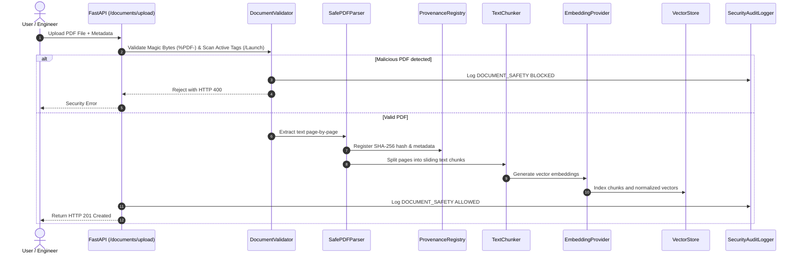
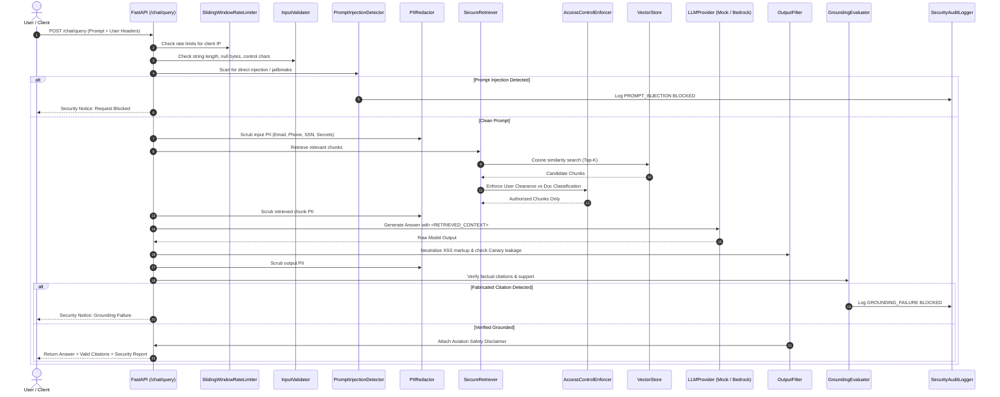

# ContextForge Data Flow Architecture

This document describes data flow paths across trust boundaries in ContextForge.

---

## 1. Document Ingestion Data Flow

---

## 2. RAG Query Execution Data Flow

